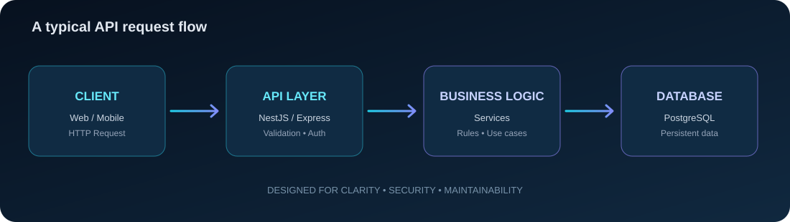

 

  

---

## 👋 About me

I'm **Ibrahem Mahmoud**, a backend developer focused on building maintainable APIs and reliable server-side applications.

- 🧩 I enjoy turning requirements into clear, structured backend solutions.
- ⚙️ Working with **Node.js, Express, NestJS, TypeScript, and PostgreSQL**.
- 🔐 Interested in API design, authentication, validation, and clean architecture.
- 🌱 Always learning, building, and improving through practical projects.
- 🎯 My goal: write code that is easy to understand, test, and maintain.

 

## 🧰 Tech stack

### Backend

### Data & Tools

## 🏗️ How I think about backend systems

I value predictable request flows, clear separation of responsibilities, useful error handling, and data models that support the product instead of complicating it.

## 📌 Featured projects

> Replace these examples with your strongest repositories. Pin your best 3–6 projects on your GitHub profile.

## 📊 GitHub activity

 

## 🐍 Contribution trail

## 🤝 Let's connect

  
Thanks for stopping by — feel free to explore my repositories and share feedback.

