 

 

## About

I'm **Ibrahem Mahmoud**, a backend engineer who builds maintainable APIs and reliable server-side applications.

- I turn requirements into clear, well-structured backend solutions.
- I work with **Node.js, Express, NestJS, TypeScript and PostgreSQL**.
- I care about API design, authentication, validation and clean architecture.
- My goal is simple: code that is easy to understand, test and maintain.

 

## Tech stack

| | |
|:--|:--|
| **Languages** |  |
| **Backend** |  |
| **Data** |  |
| **Tooling** |  |

## How I build backend systems

The banner above shows the request lifecycle I design around: every request passes through the same predictable layers.

| Principle | In practice |
|:--|:--|
| **Clear boundaries** | Controllers handle transport, services own the domain logic, repositories own data access. |
| **Validate at the edge** | DTOs, pipes and guards reject bad or unauthorized input before it reaches business logic. |
| **Fail usefully** | Consistent error responses, meaningful status codes and logs that help when something breaks. |
| **Data that serves the product** | Models and queries that support the feature instead of complicating it. |

## Featured projects

## GitHub activity

  

## Let's connect

  
Thanks for stopping by. Feel free to explore my repositories and share feedback.

